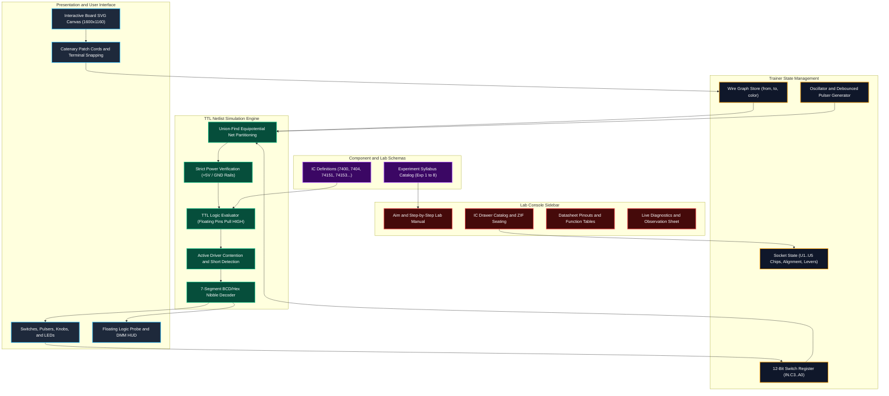
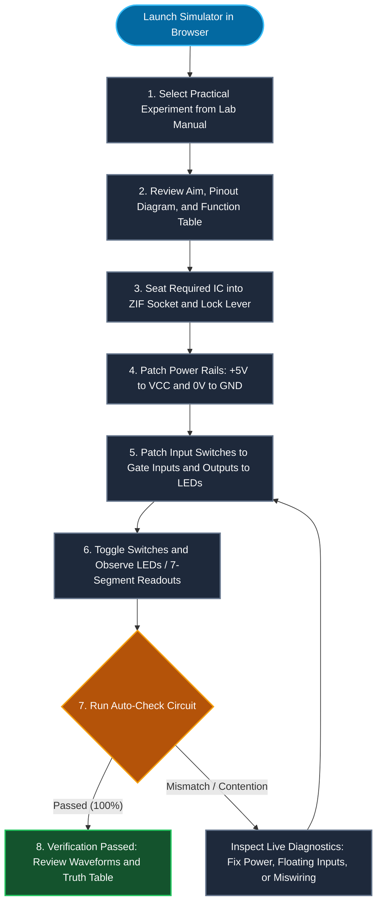
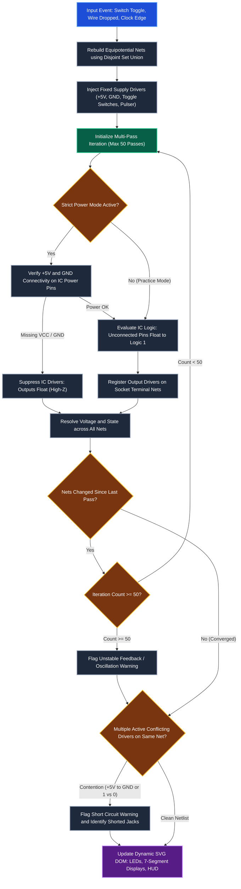
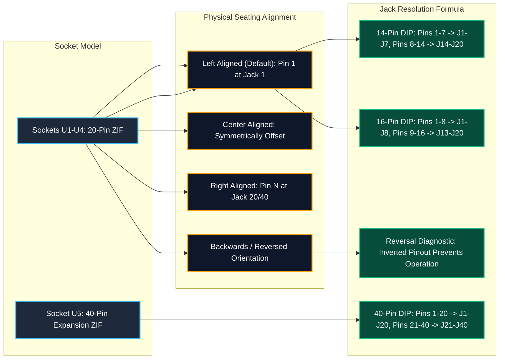
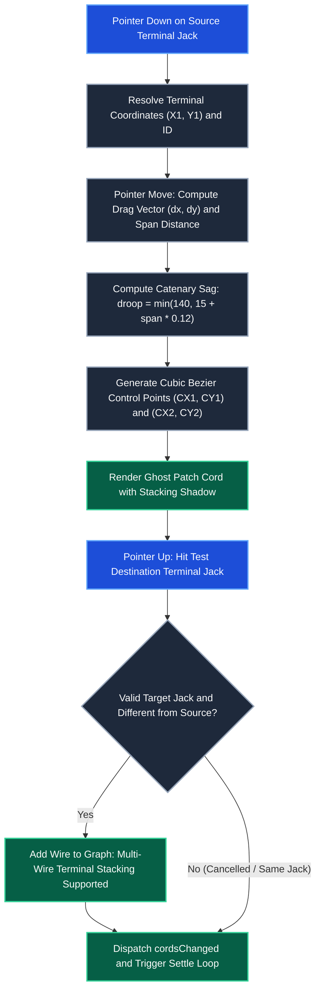
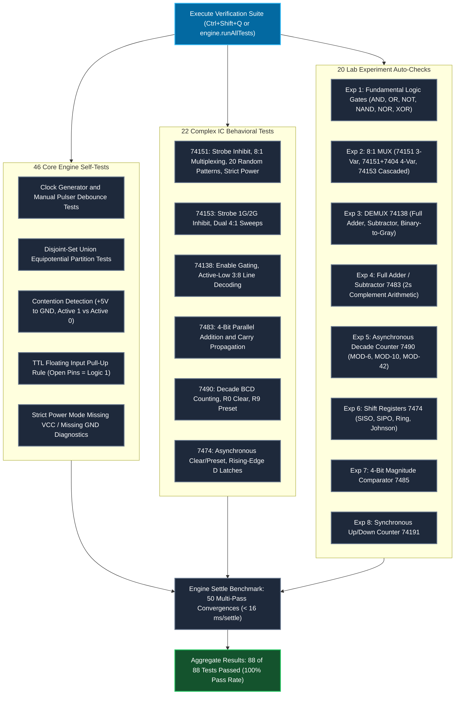

# DIT 9005 Digital IC Trainer Simulator

[](LICENSE)
[](https://developer.mozilla.org/en-US/docs/Web/JavaScript)
[](index.html)
[-38bdf8)](index.html)
[](docs/references/Kit_Layout_Addendum.md)
[](index.html)

> A zero-install, pixel-accurate virtual clone of the Hi-Tech DIT 9005 Digital IC Trainer kit.
> Designed specifically for engineering students preparing for Digital Systems practical laboratory examinations.
> Patch wires, seat physical ICs into zero-insertion-force (ZIF) sockets, probe voltages, and verify truth tables in real time.

---

## System Architecture



---

## Student Lab Workflow



---

## Real-Time Simulation Engine & Settle Loop



---

## ZIF Socket Pin Mapping & Package Alignment



---

## Patch Cord Physics & Wire Management



---

## Automated Verification & Testbench Architecture



---

## Experiment Syllabus Progression

```mermaid
flowchart LR
    classDef exp fill:#1e293b,stroke:#38bdf8,stroke-width:2px,color:#ffffff;
    classDef adv fill:#0f172a,stroke:#f59e0b,stroke-width:2px,color:#ffffff;

    E1["Exp 1: Fundamental Gates\n(7400, 7402, 7404, 7408, 7432, 7486)"]:::exp
    E2["Exp 2: Multiplexers\n(74151 Direct 8:1, 74153 Cascaded 4:1)"]:::exp
    E3["Exp 3: Decoders & Demux\n(74138 3:8 Decoder + 7420 NAND)"]:::exp
    E4["Exp 4: Binary Arithmetic\n(7483 4-Bit Adder & 2s Complement)"]:::exp
    E5["Exp 5: Decade Counters\n(7490 Asynchronous BCD & MOD-42)"]:::adv
    E6["Exp 6: Shift Registers\n(7474 Dual D-Type Flip-Flops)"]:::adv
    E7["Exp 7: Magnitude Comparator\n(7485 4-Bit Word Comparison)"]:::adv
    E8["Exp 8: Up/Down Counters\n(74191 Synchronous Directional)"]:::adv

    E1 --> E2 --> E3 --> E4 --> E5 --> E6 --> E7 --> E8
```



---

## Supported IC Catalog

| IC Part | Marking | Package | Description | VCC Pin | GND Pin | Logic Function |
|:---:|:---:|:---:|---|:---:|:---:|---|
| **7400** | SN7400N | DIP-14 | Quad 2-Input NAND Gate | 14 | 7 | 4 independent NAND gates: $Y = \overline{A \cdot B}$ |
| **7402** | SN7402N | DIP-14 | Quad 2-Input NOR Gate | 14 | 7 | 4 independent NOR gates: $Y = \overline{A + B}$ |
| **7404** | SN7404N | DIP-14 | Hex Inverter | 14 | 7 | 6 independent inverters: $Y = \overline{A}$ |
| **7408** | SN7408N | DIP-14 | Quad 2-Input AND Gate | 14 | 7 | 4 independent AND gates: $Y = A \cdot B$ |
| **7420** | SN7420N | DIP-14 | Dual 4-Input NAND Gate | 14 | 7 | 2 independent 4-input NAND gates |
| **7432** | SN7432N | DIP-14 | Quad 2-Input OR Gate | 14 | 7 | 4 independent OR gates: $Y = A + B$ |
| **7474** | SN74LS74AN | DIP-14 | Dual D Positive-Edge Flip-Flop | 14 | 7 | 2 independent D flip-flops with Preset and Clear |
| **7483** | SN74LS83N | DIP-16 | 4-Bit Binary Full Adder | 5 | 12 | 4-bit parallel adder with fast internal lookahead carry |
| **7485** | SN7485N | DIP-16 | 4-Bit Magnitude Comparator | 16 | 8 | Compares two 4-bit words ($A > B, A = B, A < B$) |
| **7486** | SN7486N | DIP-14 | Quad 2-Input XOR Gate | 14 | 7 | 4 independent XOR gates: $Y = A \oplus B$ |
| **7490** | SN74LS90N | DIP-14 | Decade BCD Counter | 5 | 10 | Divide-by-2 and divide-by-5 asynchronous counters |
| **7493** | SN7493N | DIP-14 | 4-Bit Binary Ripple Counter | 5 | 10 | 4-stage binary ripple counter (0 to 15) |
| **74138** | SN74LS138N | DIP-16 | 3-to-8 Line Decoder / Demux | 16 | 8 | Active-low 8-line output with 3 enable pins (E1, E2, E3) |
| **74151** | SN74LS151N | DIP-16 | 1-of-8 Data Selector / Multiplexer | 16 | 8 | 8 data inputs, 3 select lines, active-low strobe, complementary outputs Y and W |
| **74153** | SN74LS153N | DIP-16 | Dual 4-to-1 Multiplexer | 16 | 8 | Two 4:1 multiplexers with common select lines S1, S0 |
| **74191** | SN74191N | DIP-16 | Synchronous 4-Bit Up/Down Counter | 16 | 8 | Presettable binary counter with direction control |
| **74283** | SN74LS283N | DIP-16 | 4-Bit Binary Full Adder | 16 | 8 | Standard corner-pin power layout full adder |
| **7447** | SN74LS47N | DIP-16 | BCD-to-7-Segment Decoder / Driver | 16 | 8 | Open-collector active-low outputs for common anode displays |
| **8085** | P8085AH | DIP-40 | 8-Bit Microprocessor (U5 Expansion) | 40 | 20 | 40-pin CPU expansion socket verification model |

---

## Laboratory Experiments Catalog

| Exp | Title | Core ICs | Approaches and Syllabus Scope |
|:---:|---|---|---|
| **1** | **Study of Basic Logic Gates** | `7404`, `7408`, `7432`, `7400`, `7402`, `7486` | Verify truth tables for all 6 fundamental gates; observe TTL floating input pull-up behavior. |
| **2** | **Multiplexer (8:1 MUX & Function Generator)** | `74151`, `74153`, `7404`, `7432` | Approach 1: 74151 monolithic 8:1 MUX for $f(C,B,A)=\Sigma(0,2,3,5)$ and $f(I,J,K,L)=\Sigma(0,2,3,7,11,14,15)$ with 7404. Approach 2: 74153 cascaded 4:1 MUX with 7404 inverter and 7432 OR gate. |
| **3** | **Demultiplexer / Decoder 74138** | `74138`, `7420` | Study 3:8 decoding, Full Adder and Full Subtractor implementation, and cascaded 4:16 decoding. |
| **4** | **Binary Full Adder & Subtractor 7483** | `7483`, `7486` | 4-bit parallel binary adder and 2s complement adder/subtractor with sign overflow. |
| **5** | **Asynchronous Decade Counter 7490** | `7490` | MOD-6, MOD-10 (BCD), and MOD-42 counters with 7-segment decoded readouts. |
| **6** | **Shift Registers using Flip-Flops 7474** | `7474` | SISO, SIPO, PISO, PIPO 4-bit registers and Ring/Johnson counters. |
| **7** | **4-Bit Magnitude Comparator 7485** | `7485` | Compares two 4-bit words ($A > B, A = B, A < B$) with cascading expansion. |
| **8** | **Synchronous Up/Down Counter 74191** | `74191` | Synchronous 4-bit up/down counting, preloading, and ripple clock carry flags. |

---

## Keyboard Shortcuts

| Shortcut | Context | Action |
|---|---|---|
| **`Space + Drag`** | Board Canvas | Pan the view across the green trainer PCB |
| **`Scroll Wheel`** | Board Canvas | Zoom in / Zoom out centered on cursor position |
| **`Enter` / `Space`** | Focused Jack | Start patch cord connection / Complete patch cord connection |
| **`Enter` / `Space`** | Focused Switch | Toggle switch position between Logic 0 (Down) and Logic 1 (Up) |
| **`Enter` / `Space`** | Focused ZIF Lever | Lock / unlock socket ZIF lever |
| **`Escape`** | Global | Cancel in-progress wire, deselect cord, or close open dialogs |
| **`Delete` / `Backspace`** | Selected Cord | Remove the currently selected patch cord |
| **`Ctrl + Z`** (or `Cmd + Z`) | Global | Undo last patch cord connection or disconnection |
| **`Ctrl + Y`** (or `Cmd + Shift + Z`) | Global | Redo previously undone patch cord action |
| **`Ctrl + Shift + Q`** (or `Cmd + Shift + Q`) | Global | Open Automated QA & Benchmark Suite dialog |

---

## Frequently Asked Questions

### Why does my output LED not light up?
1. **Check Power Mode**: By default, **Strict Power Mode** is active. Connect a patch cord from `+5V` to the IC's $V_{CC}$ pin and `GND` to the IC's ground pin.
2. **Check ZIF Socket Lever**: Ensure the socket lever is locked (horizontal/down position). An open lever disconnects all pins.
3. **Check IC Placement**: Open the **IC Drawer** tab to verify an IC is inserted into the correct socket (`U1`–`U5`) with matching alignment (Pin 1 at top-left).
4. **Use Diagnostics**: Click the **Diagnostics** tab in the sidebar to review the live Netlist and verify the socket voltages.

### Why does an unconnected / open IC pin read HIGH (Logic 1)?
This reflects genuine **TTL bipolar logic behavior**. In standard 74-series TTL circuits (such as 7408, 7400, or 74151), input transistor emitters left unconnected float to approximately $+1.8\text{V}\text{--}+2.4\text{V}$, which the internal transistor interprets as a valid **Logic HIGH**. Connecting the pin to `GND` pulls it to $0\text{V}$ (Logic LOW).

### How do I remove a patch cord?
- **Method 1**: Right-click on any patch cord or its terminal banana plug.
- **Method 2**: Click the cord once to select it (highlighted), then press `Delete` or `Backspace`.
- **Method 3**: Click **"Delete Wire"** in the header to enter Delete Mode, then click any cord.

### How do I practice under realistic exam conditions?
Click the **"Exam Mode"** button in the header toolbar. This disables the "Auto-Wire Circuit", "Hint", and "Show Solution" assistance, requiring you to consult only the schematic and pinout diagrams.

---

## Local Offline Execution & Deployment

### Local Offline Execution (Zero Dependencies)
No build tools, node daemons, or internet connections are required:
```bash
# Clone the repository
git clone https://github.com/AdityaSurse/DS-simulations.git
cd DS-simulations

# Open index.html directly in any browser
open index.html        # macOS
start index.html       # Windows
xdg-open index.html    # Linux
```

### Static Deployment
- **GitHub Pages**: Go to **Settings** -> **Pages**, set **Source** to `Deploy from a branch`, choose branch `main` and folder `/ (root)`.
- **Vercel**: Pre-configured via `vercel.json` for static clean URLs. Deploy with `vercel --prod`.

---

## Project Structure

```text
DS-simulations/
├── index.html                 # Single deliverable application (HTML + CSS + Vanilla JS + SVG)
├── build_index.py             # Concatenates modular source parts into index.html
├── vercel.json                # Vercel static deployment configuration
├── README.md                  # Technical architecture and flowchart documentation
├── docs/
│   └── references/
│       ├── DIT9005_upright.png # Reference photo of physical DIT 9005 hardware
│       ├── Kit_Layout_Addendum.md # Physical coordinates, zone % layout, and socket pinouts
│       └── DC Lab Manual 2022-23 (AutoRecovered)-2.pdf # University lab syllabus reference
└── src_parts/                 # Modular source components
    ├── tokens.css             # Color tokens, typography, shadows, and layout variables
    ├── data_ics.js            # IC definitions, pinouts, truth tables, and behavioral eval
    ├── data_experiments.js    # Lab manual experiments, procedures, and solution wiring
    ├── engine.js              # TTL netlist solver, multi-pass settle loop, and testbench
    ├── components.js          # Parametric SVG component renderers (ZIF, DIP, Cords, HUD)
    ├── board.js               # Interactive canvas, coordinate system, and event handling
    ├── console.js             # Sidebar tabs (Aim, Drawer, Reference, Diagnostics)
    └── init.js                # Application bootstrap and state initialization
```

---

## License

Distributed under the **MIT License**. Built for engineering students mastering digital logic systems.
