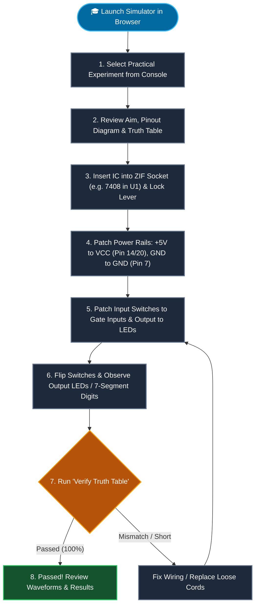
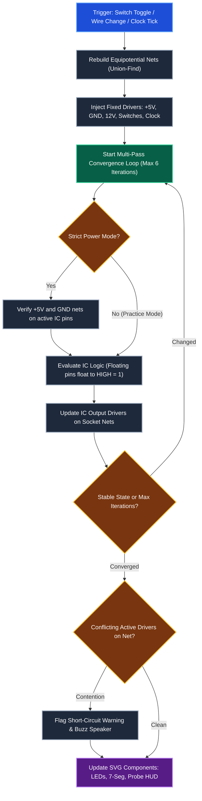
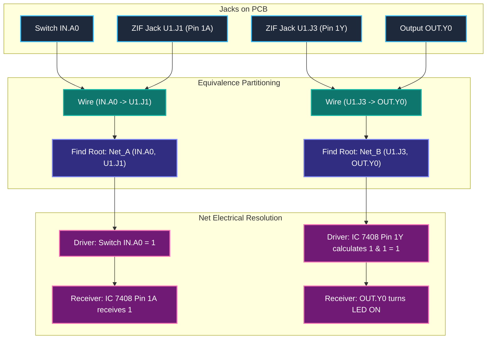
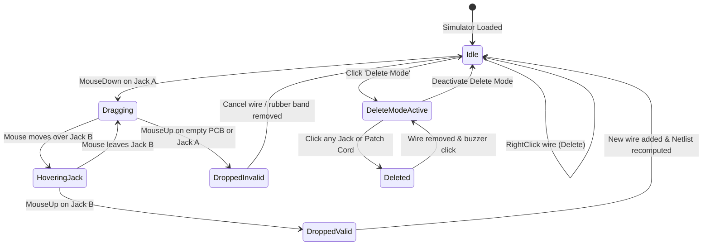
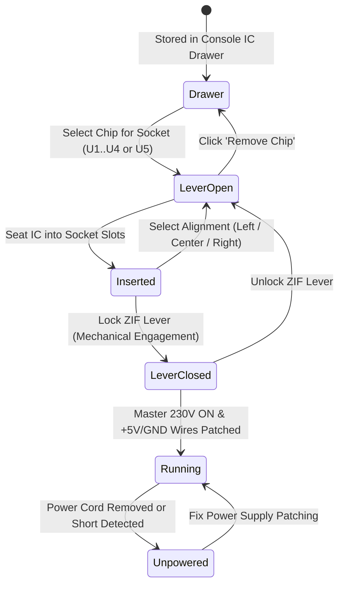
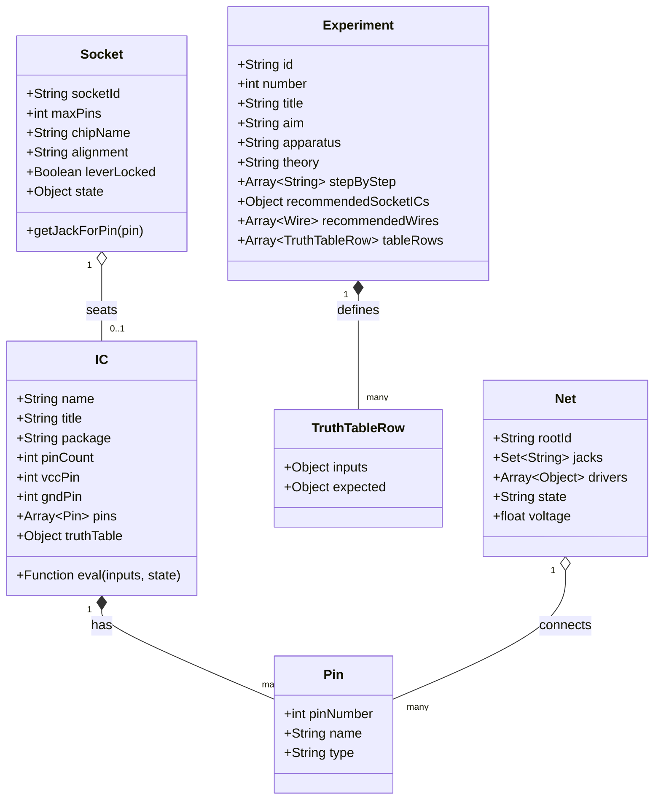

# 🔌 DIT 9005 Digital IC Trainer Simulator

[](LICENSE)
[](https://developer.mozilla.org/en-US/docs/Web/JavaScript)
[](index.html)
[-38bdf8)](index.html)
[](docs/references/Kit_Layout_Addendum.md)

> **A zero-install, pixel-accurate virtual clone of the Hi-Tech DIT 9005 Digital IC Trainer kit.**  
> Designed specifically for engineering students preparing for Digital Systems practical lab exams.  
> Patch wires, seat physical ICs into zero-insertion-force (ZIF) sockets, probe voltages, and verify truth tables in real time.

---

## 🎯 Why This Exists

1. **Hardware Scarcity & Broken Lab Kits**: In real-world university laboratories, breadboards and trainer kits often suffer from bent IC socket pins, burned 74-series chips from prior batches, faulty ground rails, and intermittent patch cords.
2. **Pre-Exam Muscle Memory**: Digital practical exams test speed and circuit layout confidence under pressure. Students need to instinctively know which pin is $V_{CC}$ (Pin 14/16/5) or GND (Pin 7/8/12), how 14-pin ICs align in 20-pin sockets, and how to read decoded 7-segment output nibbles.
3. **True TTL Physics**: Many web circuit simulators treat inputs as high-impedance zeroes or perfect ideal equations. The DIT 9005 Simulator models genuine **transistor-transistor logic (TTL)** quirks: **floating inputs float to logic 1**, unpowered ICs pull no currents, and conflicting active drivers trigger real **short-circuit warnings**.

---

## ✨ Features

- 🎛️ **Authentic 3D Hardware Aesthetics**: Realistic teak/wood-grain frame with countersunk brass screws, dark green solder-mask PCB, brass eyelet jacks, mechanical SPST bat switches, red push buttons, bakelite knurled rotary knobs, and diffused 5mm epoxy LEDs.
- 🟡 **Physics-Based Sagging Patch Cords**: True catenary Bézier curvature with ground drop shadows, specularity highlights, and 3D banana plug boots in 6 standard lab colors (Yellow, Red, Black, Blue, Green, White).
- 🖲️ **Zero-Insertion-Force (ZIF) Sockets**: Four 20-pin ZIF sockets (`U1`–`U4`) and one 40-pin universal expansion socket (`U5`) with animated mechanical levers and customizable pin-1 alignments.
- ⚡ **Strict vs Practice Power Modes**: In default strict mode, students must run physical jumper wires from $+5\text{V}$ and $\text{GND}$ rails to the corresponding IC pins before gates activate.
- 🔄 **Integrated Clock & Manual Pulsers**: On-board variable frequency oscillator ($1\text{Hz}$ to $500\text{Hz}$) with blinking indicator LED, plus dual debounced Schmitt-trigger (`CD4093`) push buttons with complementary $Q$ and $\bar{Q}$ outputs.
- 🔢 **Dual 7-Segment & 8-Bit LED Output**: High-contrast red 7-segment hex/BCD displays driven by internal decoders from output jacks $Y_7\text{–}Y_0$.
- 📋 **Integrated Practical Exam Experiments**: Pre-configured guided lab manual experiments (Study of Gates, MUX 74153, DEMUX 74138, Adder 7483, Comparator 7485, Counter 7490, and Up/Down Counter 74191).
- 🧪 **One-Click Truth Table Auto-Verification**: Automated test-bench cycles through input combinations, tests student wiring against expected truth tables, and pinpoints wiring bugs.
- 🔍 **Interactive Logic Probe & DMM**: Hover over or click any terminal jack to inspect instantaneous voltage, logic state (`HIGH`, `LOW`, `FLOAT`, `SHORT`), and driver netlists.
- 🔊 **Tactile Web Audio Feedback**: Realistic mechanical switch clicks, plug insertions, and overload buzzer alarms synthesized via the Web Audio API.

---

## 🏛️ System Architecture & Workflow Diagrams

### 1. System Architecture


---

### 2. Student User Journey


---

### 3. Simulation Loop Architecture


---

### 4. Netlist Construction via Union-Find


---

### 5. Patch Cord Interaction State Machine


---

### 6. IC Lifecycle in Socket


---

### 7. Experiment Data Model


---

### 8. Implementation Roadmap (Phases 1–10)
```mermaid
gantt
    title DIT 9005 Implementation Roadmap (Phases 1 to 10)
    dateFormat  YYYY-MM-DD
    axisFormat  %d %b

    section Architecture & Docs
    Phase 1: Architecture & Visual README      :done,    p1, 2026-11-01, 2026-11-02

    section Hardware UI & Layout
    Phase 2: Design Tokens & SVG Layout Shell   :done,    p2, 2026-11-02, 2026-11-03
    Phase 3: 3D SVG Components (Jacks, ICs)     :done,    p3, 2026-11-03, 2026-11-05

    section Simulation Engine
    Phase 4: Catenary Patch Cords & Snapping    :done,    p4, 2026-11-05, 2026-11-07
    Phase 5: Union-Find Netlist & TTL Physics   :done,    p5, 2026-11-07, 2026-11-09
    Phase 6: 74-Series IC Library Database      :done,    p6, 2026-11-09, 2026-11-11

    section Console & Experiments
    Phase 7: Clock, Pulser & 7-Segment Output   :done,    p7, 2026-11-11, 2026-11-13
    Phase 8: Laboratory Console & IC Drawer     :done,    p8, 2026-11-13, 2026-11-15
    Phase 9: Experiments 1-8 & Auto-Verifier    :done,    p9, 2026-11-15, 2026-11-17
    Phase 10: Logic Probe HUD, Audio & Polish   :done,    p10, 2026-11-17, 2026-11-19
```

---

## 💾 Supported IC Catalog

| IC Part | Family | Pins | Description | $V_{CC}$ Pin | GND Pin | Internal Logic Structure |
|:---:|:---:|:---:|---|:---:|:---:|---|
| **7400** | TTL | 14 | Quad 2-Input NAND Gate | 14 | 7 | 4 independent NAND gates: $Y = \overline{A \cdot B}$ |
| **7402** | TTL | 14 | Quad 2-Input NOR Gate | 14 | 7 | 4 independent NOR gates: $Y = \overline{A + B}$ |
| **7404** | TTL | 14 | Hex Inverter | 14 | 7 | 6 independent inverters: $Y = \overline{A}$ |
| **7408** | TTL | 14 | Quad 2-Input AND Gate | 14 | 7 | 4 independent AND gates: $Y = A \cdot B$ |
| **7420** | TTL | 14 | Dual 4-Input NAND Gate | 14 | 7 | 2 independent 4-input NAND gates |
| **7432** | TTL | 14 | Quad 2-Input OR Gate | 14 | 7 | 4 independent OR gates: $Y = A + B$ |
| **7474** | TTL | 14 | Dual D Positive-Edge Flip-Flop | 14 | 7 | 2 independent D flip-flops with Preset & Clear |
| **7483** | TTL | 16 | 4-Bit Binary Full Adder | 5 | 12 | 4-bit parallel adder with fast carry |
| **7485** | TTL | 16 | 4-Bit Magnitude Comparator | 16 | 8 | Compares two 4-bit words ($A > B, A = B, A < B$) |
| **7486** | TTL | 14 | Quad 2-Input XOR Gate | 14 | 7 | 4 independent XOR gates: $Y = A \oplus B$ |
| **7490** | TTL | 14 | Decade BCD Counter | 5 | 10 | Divide-by-2 and divide-by-5 asynchronous counters |
| **7493** | TTL | 14 | 4-Bit Binary Ripple Counter | 5 | 10 | 4-stage binary ripple counter (0 to 15) |
| **74138** | TTL | 16 | 3-to-8 Line Decoder / Demux | 16 | 8 | Active-low 8-line output with 3 enable pins |
| **74153** | TTL | 16 | Dual 4-to-1 Multiplexer | 16 | 8 | Two 4:1 multiplexers with common select lines |
| **74191** | TTL | 16 | Synchronous 4-Bit Up/Down Counter | 16 | 8 | Single clock synchronous counter with direction control |

---

## 🧪 Experiments Catalog

| Exp # | Experiment Title | Core ICs Required | Purpose & Syllabus Learning Outcome |
|:---:|---|---|---|
| **1** | **Study of Basic Logic Gates** | `7404`, `7408`, `7432`, `7400`, `7402`, `7486` | Verify truth tables for all 6 fundamental gates; observe floating inputs. |
| **2** | **TTL & CMOS Electrical Parameters** | `7404`, `7400` | Measure voltage thresholds ($V_{OH}, V_{OL}, V_{IH}, V_{IL}$) and fan-out limits. |
| **3** | **Multiplexer using IC 74153** | `74153` | Implement 4:1 data selection and expand to 8:1 multiplexer logic. |
| **4** | **Demultiplexer / Decoder 74138** | `74138` | Study 3:8 decoding and implement a Full Adder circuit using decoders. |
| **5** | **Binary Full Adder & Subtractor 7483** | `7483`, `7486` | Perform 4-bit binary addition and 2's complement subtraction. |
| **6** | **Magnitude Comparator 7485** | `7485` | Compare two 4-bit binary numbers ($A$ and $B$) with cascading inputs. |
| **7** | **Asynchronous Counters (7490 / 7493)** | `7490`, `7493` | Build MOD-6, MOD-10 (BCD), and MOD-42 frequency dividing counters. |
| **8** | **Synchronous Up/Down Counter 74191** | `74191`, `7474` | Clock-driven reversible 4-bit counter with load and ripple carry flags. |

---

## 📂 Project Structure

```text
dit9005-trainer-simulator/
├── index.html                 # 🚀 SINGLE DELIVERABLE (HTML + CSS + Vanilla JS, SVG)
├── build_index.py             # Optional developer bundler from modular source parts
├── README.md                  # Complete architectural & visual project documentation
├── docs/
│   └── references/
│       ├── DIT9005_upright.png # Upright laboratory reference photo of physical hardware
│       ├── Kit_Layout_Addendum.md # Exact coordinates, physical zone %, and socket pinouts
│       └── DC Lab Manual 2022-23 (AutoRecovered)-2.pdf # University lab syllabus reference
└── src_parts/                 # Clean, modular developer source parts
    ├── tokens.css             # /* ===== TOKENS ===== */
    ├── data_ics.js            # /* ===== DATA: ICs ===== */
    ├── data_experiments.js    # /* ===== DATA: EXPERIMENTS ===== */
    ├── engine.js              # /* ===== ENGINE ===== */
    ├── components.js          # /* ===== COMPONENTS ===== */
    ├── board.js               # /* ===== BOARD ===== */
    ├── console.js             # /* ===== CONSOLE ===== */
    └── init.js                # /* ===== INIT ===== */
```

---

## 🚀 Running Locally & Free Deployment

### Local Execution (Zero Setup)
No build steps, package managers, or server daemons are needed:
1. Clone or download the repository:
   ```bash
   git clone https://github.com/your-username/dit9005-simulator.git
   cd dit9005-simulator
   ```
2. Open [`index.html`](file:///Users/adityasurse/Documents/Trainer%20kit%20sim/index.html) directly in any web browser:
   ```bash
   open index.html   # On macOS
   start index.html  # On Windows
   xdg-open index.html # On Linux
   ```

### Free Deployment on GitHub Pages
1. Go to your GitHub repository **Settings** $\to$ **Pages**.
2. Select **Source**: `Deploy from a branch`.
3. Select **Branch**: `main`, Folder: `/ (root)`.
4. Click **Save**. Your simulator will be live at `https://<username>.github.io/dit9005-simulator/`.

### Free Deployment on Vercel
1. Install Vercel CLI (`npm i -g vercel`) or link the GitHub repo in the [Vercel Dashboard](https://vercel.com).
2. Deploy with zero configuration:
   ```bash
   vercel --prod
   ```

---

## 🗺️ Implementation Roadmap Checklist

- [x] **Phase 1: Architecture & Rich Documentation** (Detailed `README.md`, Mermaid diagrams, IC tables)
- [x] **Phase 2: Design Tokens & Exact Trainer SVG Layout** (Green PCB, wood frame, 8 hardware zones)
- [x] **Phase 3: 3D SVG Hardware Components** (Brass jacks, switches, push buttons, LEDs, 7-seg, ZIF sockets)
- [x] **Phase 4: Interactive Patch Cording** (Sagging Bézier curves, multi-color palette, hover snapping, deletion)
- [x] **Phase 5: Simulation Engine & Real TTL Physics** (Union-find netlist, strict power mode, floating inputs = 1, short circuit alarms)
- [x] **Phase 6: Comprehensive 74-Series IC Library** (Gate logic, decoders, multiplexers, adders, counters)
- [x] **Phase 7: Integrated Clock, Pulser & Output Displays** (Variable frequency oscillator, debounced pulsers, dual 7-segment hex decoder)
- [x] **Phase 8: Laboratory Console & IC Drawer** (Tabbed sidebar, socket management, alignment settings, reference pinouts)
- [x] **Phase 9: University Practical Experiments** (Experiments 1–8, auto-wiring demos, automated truth table verification)
- [x] **Phase 10: Diagnostics, Audio Synthesis & Final Polish** (Logic probe HUD, Web Audio switch clicks and buzzers, JSON import/export)

---

## 🤝 Contributing

Contributions to expand the IC library (such as additional 74-series sequential chips or CMOS 4000 series equivalents) or to add new university lab experiments are welcome!
1. Fork the Project.
2. Create your Feature Branch (`git checkout -b feature/Add-IC-74194`).
3. Commit your Changes (`git commit -m 'Add 74194 Universal Shift Register'`).
4. Push to the Branch (`git push origin feature/Add-IC-74194`).
5. Open a Pull Request.

---

## 📄 License

Distributed under the **MIT License**. See `LICENSE` for more information.

*Original branding and implementation: **DIT 9005 Simulator** — Built with pride for engineering students.*

