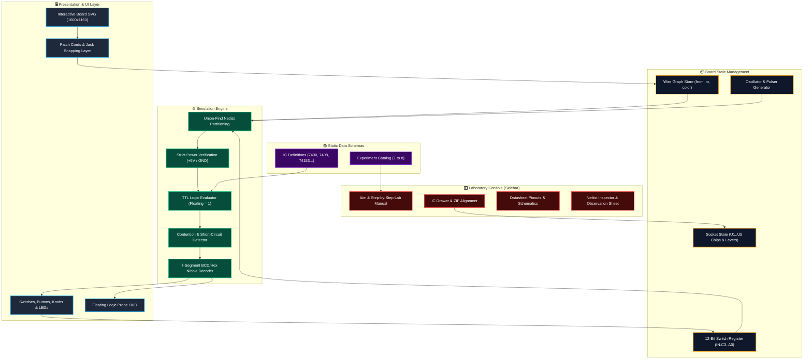
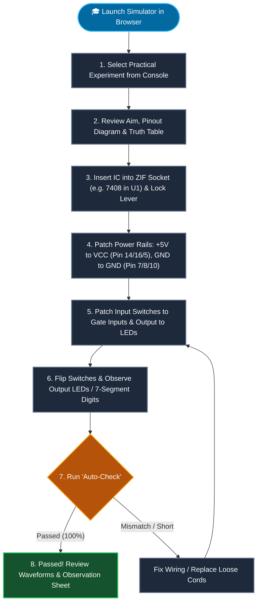
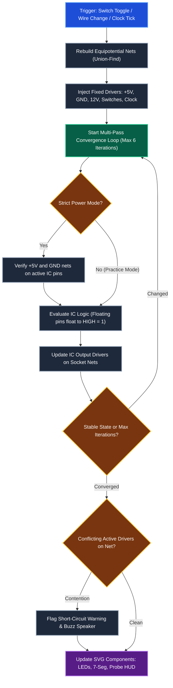

# 🔌 DIT 9005 Digital IC Trainer Simulator

[](LICENSE)
[](https://developer.mozilla.org/en-US/docs/Web/JavaScript)
[](index.html)
[-38bdf8)](index.html)
[](docs/references/Kit_Layout_Addendum.md)
[](index.html)

> **A zero-install, pixel-accurate virtual clone of the Hi-Tech DIT 9005 Digital IC Trainer kit.**  
> Designed specifically for engineering students preparing for Digital Systems practical lab exams.  
> Patch wires, seat physical ICs into zero-insertion-force (ZIF) sockets, probe voltages, and verify truth tables in real time.

---

## 🎯 Why This Exists

1. **Hardware Scarcity & Broken Lab Kits**: In real-world university laboratories, breadboards and trainer kits often suffer from bent IC socket pins, burned 74-series chips from prior batches, faulty ground rails, and intermittent patch cords.
2. **Pre-Exam Muscle Memory**: Digital practical exams test speed and circuit layout confidence under pressure. Students need to instinctively know which pin is $V_{CC}$ (Pin 14/16/5) or GND (Pin 7/8/12), how 14-pin ICs align in 20-pin sockets, and how to read decoded 7-segment output nibbles.
3. **True TTL Physics**: Many web circuit simulators treat inputs as high-impedance zeroes or perfect ideal equations. The DIT 9005 Simulator models genuine **transistor-transistor logic (TTL)** quirks: **floating inputs float to logic 1**, unpowered ICs pull no currents, and conflicting active drivers trigger real **short-circuit warnings**.

---

## ✨ Features

- 🎛️ **Authentic 3D Hardware Aesthetics**: Realistic teak/wood-grain frame with countersunk brass screws, dark green solder-mask PCB, brass eyelet jacks, mechanical SPST bat switches, red push buttons, bakelite knurled rotary knobs, and diffused 5mm epoxy LEDs.
- 🟡 **Physics-Based Sagging Patch Cords**: True catenary Bézier curvature with ground drop shadows, specularity highlights, subtle insertion rebound wobble, and 3D banana plug boots in 6 standard lab colors (Yellow, Red, Black, Blue, Green, White).
- 🖲️ **Zero-Insertion-Force (ZIF) Sockets**: Four 20-pin ZIF sockets (`U1`–`U4`) and one 40-pin universal expansion socket (`U5`) with animated mechanical levers and customizable pin-1 alignments.
- ⚡ **Strict vs Practice Power Modes**: In default strict mode, students must run physical jumper wires from $+5\text{V}$ and $\text{GND}$ rails to the corresponding IC pins before gates activate.
- 🔄 **Integrated Clock & Manual Pulsers**: On-board variable frequency oscillator ($0.5\text{Hz}$ to $10\text{kHz}$) with blinking indicator LED, plus dual debounced Schmitt-trigger (`CD4093`) push buttons with complementary $Q$ and $\bar{Q}$ outputs.
- 🔢 **Dual 7-Segment & 8-Bit LED Output**: High-contrast red 7-segment hex/BCD displays driven by internal decoders from output jacks $Y_7\text{–}Y_0$, plus 8 discrete monitor LEDs.
- 📋 **Integrated Practical Exam Experiments**: Pre-configured guided lab manual experiments (Study of Gates, MUX 74153, DEMUX 74138, Adder 7483, Counter 7490, Shift Register 7474, Comparator 7485, and Up/Down Counter 74191).
- 🧪 **One-Click Truth Table Auto-Verification**: Automated test-bench cycles through input combinations, tests student wiring against expected truth tables, and pinpoints wiring bugs.
- 🔍 **Interactive Logic Probe & DMM HUD**: Hover over or click any terminal jack to inspect instantaneous voltage, logic state (`HIGH`, `LOW`, `FLOAT`, `SHORT`), and driver netlists.
- 🔊 **Tactile Web Audio Feedback (Optional, OFF by default)**: Realistic mechanical switch clicks, lever snaps, and overload buzzer alarms synthesized via the Web Audio API.
- 📱 **Complete Touch & Mobile Gestures**: Pinch-to-zoom, two-finger pan, and tap-jack to tap-jack wiring with expanded hitboxes (`r="22"`) and `touch-action: none;`.
- 🌓 **Theme & Accessibility Support**: Light/Dark shell toggle, High-Contrast mode, keyboard focus rings (`:focus-visible`), and full ARIA screen-reader attributes.
- 🛠️ **Built-in QA Verification Suite (`Ctrl+Shift+Q`)**: 79 automated checks testing every IC model, engine self-test, experiment solution, and an engine settle latency benchmark (< 16 ms/settle).

---

## 🏛️ System Architecture & Workflow Diagrams

### 1. System Architecture


---

### 2. Student User Journey


---

### 3. Simulation Loop Architecture


---

## ⌨️ Keyboard Shortcuts

| Shortcut | Context | Action |
|---|---|---|
| **`Space + Drag`** | Board Canvas | Pan the view across the green trainer PCB |
| **`Scroll Wheel`** | Board Canvas | Zoom in / Zoom out centered on cursor position |
| **`Enter` / `Space`** | Focused Jack | Start patch cord connection / Complete patch cord connection |
| **`Enter` / `Space`** | Focused Switch | Toggle switch position between Logic 0 (Down) and Logic 1 (Up) |
| **`Enter` / `Space`** | Focused ZIF Lever | Lock / unlock socket ZIF lever |
| **`Escape`** | Global | Cancel in-progress wire, deselect cord, or close open modals |
| **`Delete` / `Backspace`** | Selected Cord | Remove the currently selected patch cord |
| **`Ctrl + Z`** (or `Cmd + Z`) | Global | Undo last patch cord connection or disconnection |
| **`Ctrl + Y`** (or `Cmd + Shift + Z`) | Global | Redo previously undone patch cord action |
| **`Ctrl + Shift + Q`** (or `Cmd + Shift + Q`) | Global | Open **Automated QA & Benchmark Suite** dialog |

---

## 💾 Supported IC Catalog

| IC Part | Family | Pins | Description | $V_{CC}$ Pin | GND Pin | Internal Logic Structure |
|:---:|:---:|:---:|---|:---:|:---:|---|
| **7400** | TTL | 14 | Quad 2-Input NAND Gate | 14 | 7 | 4 independent NAND gates: $Y = \overline{A \cdot B}$ |
| **7402** | TTL | 14 | Quad 2-Input NOR Gate | 14 | 7 | 4 independent NOR gates: $Y = \overline{A + B}$ |
| **7404** | TTL | 14 | Hex Inverter | 14 | 7 | 6 independent inverters: $Y = \overline{A}$ |
| **7408** | TTL | 14 | Quad 2-Input AND Gate | 14 | 7 | 4 independent AND gates: $Y = A \cdot B$ |
| **7420** | TTL | 14 | Dual 4-Input NAND Gate | 14 | 7 | 2 independent 4-input NAND gates |
| **7432** | TTL | 14 | Quad 2-Input OR Gate | 14 | 7 | 4 independent OR gates: $Y = A + B$ |
| **7474** | TTL | 14 | Dual D Positive-Edge Flip-Flop | 14 | 7 | 2 independent D flip-flops with Preset & Clear |
| **7483** | TTL | 16 | 4-Bit Binary Full Adder | 5 | 12 | 4-bit parallel adder with fast carry |
| **7485** | TTL | 16 | 4-Bit Magnitude Comparator | 16 | 8 | Compares two 4-bit words ($A > B, A = B, A < B$) |
| **7486** | TTL | 14 | Quad 2-Input XOR Gate | 14 | 7 | 4 independent XOR gates: $Y = A \oplus B$ |
| **7490** | TTL | 14 | Decade BCD Counter | 5 | 10 | Divide-by-2 and divide-by-5 asynchronous counters |
| **7493** | TTL | 14 | 4-Bit Binary Ripple Counter | 5 | 10 | 4-stage binary ripple counter (0 to 15) |
| **74138** | TTL | 16 | 3-to-8 Line Decoder / Demux | 16 | 8 | Active-low 8-line output with 3 enable pins |
| **74153** | TTL | 16 | Dual 4-to-1 Multiplexer | 16 | 8 | Two 4:1 multiplexers with common select lines |
| **74191** | TTL | 16 | Synchronous 4-Bit Up/Down Counter | 16 | 8 | Single clock synchronous counter with direction control |

---

## 🧪 Experiments Catalog

| Exp # | Experiment Title | Core ICs Required | Purpose & Syllabus Learning Outcome |
|:---:|---|---|---|
| **1** | **Study of Basic Logic Gates** | `7404`, `7408`, `7432`, `7400`, `7402`, `7486` | Verify truth tables for all 6 fundamental gates; observe floating inputs. |
| **2** | **Multiplexer using IC 74153** | `74153` | Implement 4:1 data selection, Full Adder via MUX, and expand to 8:1 logic. |
| **3** | **Demultiplexer / Decoder 74138** | `74138` | Study 3:8 decoding, Full Subtractor implementation, and cascaded 4:16 decoding. |
| **4** | **Binary Full Adder & Subtractor 7483** | `7483`, `7486` | 4-bit parallel adder and 2's complement adder/subtractor with sign overflow. |
| **5** | **Asynchronous Decade Counter 7490** | `7490` | MOD-6, MOD-10 (BCD), and MOD-42 counters with 7-segment decoded readouts. |
| **6** | **Shift Registers using Flip-Flops 7474** | `7474` | SISO, SIPO, PISO, PIPO 4-bit registers and Ring/Johnson counters. |
| **7** | **4-Bit Magnitude Comparator 7485** | `7485` | Compares two 4-bit words ($A > B, A = B, A < B$) with cascading expansion. |
| **8** | **Synchronous Up/Down Counter 74191** | `74191` | Synchronous 4-bit up/down counting, preloading, and ripple clock carry flags. |

---

## ❓ Frequently Asked Questions (FAQ)

### Q: Why does my output LED not light up?
1. **Check Power Mode**: By default, **Strict Power Mode** is active. You must connect a patch cord from `+5V` to the IC's $V_{CC}$ pin and `GND` to the IC's ground pin.
2. **Check ZIF Socket Lever**: Ensure the socket lever is locked (horizontal/down position). An open lever disconnects all pins.
3. **Check IC Placement**: Open the **IC Drawer** tab to verify an IC is inserted into the correct socket (`U1`–`U5`) with matching alignment (Pin 1 at top-left).
4. **Use Diagnostics**: Click the **Diagnostics** tab in the sidebar to review the live Netlist and verify the socket voltages.

### Q: Why does an unconnected / open IC pin read HIGH (Logic 1)?
- This is physically accurate **TTL bipolar logic behavior**. In standard 74-series TTL circuits (such as 7408 or 7400), input transistor emitters left unconnected float to approximately $+1.8\text{V}\text{--}+2.4\text{V}$, which the internal transistor interprets as a valid **Logic HIGH**. Connecting it to `GND` pulls it to $0\text{V}$ (Logic LOW).

### Q: How do I remove a patch cord?
- **Option 1**: Right-click on any patch cord or its terminal banana plug.
- **Option 2**: Click the cord once to select it (glowing highlight), then press `Delete` or `Backspace`.
- **Option 3**: Click **"✕ Delete Wire"** in the header to enter Delete Mode, then click any cord.

### Q: How do I practice under realistic exam conditions?
- Click the **"🎓 Exam Mode"** button in the header toolbar. This hides the "⚡ Auto-Wire Circuit", "💡 Hint", and "👁️ Show Solution" buttons, forcing you to consult only the schematic and pinout diagrams.

---

## 🚀 Running Locally & Free Deployment

### Local Offline Execution (Zero Setup)
No build steps, node daemons, or internet connections are required:
1. Clone or download the repository:
   ```bash
   git clone https://github.com/your-username/dit9005-simulator.git
   cd dit9005-simulator
   ```
2. Double-click or open [`index.html`](file:///Users/adityasurse/Documents/Trainer%20kit%20sim/index.html) directly in any modern browser:
   ```bash
   open index.html   # macOS
   start index.html  # Windows
   xdg-open index.html # Linux
   ```

### Free Deployment on GitHub Pages
1. Push the repository to GitHub.
2. In your repo, go to **Settings** $\to$ **Pages**.
3. Under **Build and deployment**, select **Source**: `Deploy from a branch`.
4. Choose Branch `main` and Folder `/ (root)`. Click **Save**.
5. Your simulator is immediately live at `https://<username>.github.io/<repo-name>/`.

### Free Deployment on Vercel
1. The repository includes [`vercel.json`](file:///Users/adityasurse/Documents/Trainer%20kit%20sim/vercel.json) pre-configured for static clean URLs.
2. Import the repository in [Vercel Dashboard](https://vercel.com) or run:
   ```bash
   vercel --prod
   ```

---

## 📂 Project Structure

```text
dit9005-trainer-simulator/
├── index.html                 # 🚀 SINGLE DELIVERABLE (HTML + CSS + Vanilla JS, SVG)
├── build_index.py             # Modular build script concatenating src_parts into index.html
├── vercel.json                # Vercel static deployment configuration
├── README.md                  # Complete architectural & user documentation
├── docs/
│   └── references/
│       ├── DIT9005_upright.png # Upright laboratory reference photo of physical hardware
│       ├── Kit_Layout_Addendum.md # Exact coordinates, physical zone %, and socket pinouts
│       └── DC Lab Manual 2022-23 (AutoRecovered)-2.pdf # University lab syllabus reference
└── src_parts/                 # Clean, modular developer source parts
    ├── tokens.css             # /* ===== TOKENS ===== */
    ├── data_ics.js            # /* ===== DATA: ICs ===== */
    ├── data_experiments.js    # /* ===== DATA: EXPERIMENTS ===== */
    ├── engine.js              # /* ===== ENGINE ===== */
    ├── components.js          # /* ===== COMPONENTS ===== */
    ├── board.js               # /* ===== BOARD ===== */
    ├── console.js             # /* ===== CONSOLE ===== */
    └── init.js                # /* ===== INIT ===== */
```

---

## 📄 License

Distributed under the **MIT License**. Built with pride for engineering students mastering digital logic systems.
